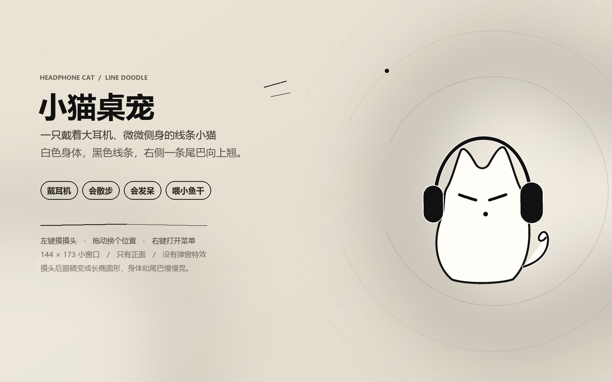

# 小猫桌宠



## 直接下载（Windows，无需 Python）

[**下载 MochiCat-Windows.zip**](https://github.com/cxt425/mochi-headphone-cat/releases/latest)

解压后双击 `MochiCat.exe` 就能运行，不需要安装 Python。首次运行如果出现 Windows SmartScreen 提示，点“更多信息” → “仍要运行”。

一只戴着大耳机的极简线条小猫：白色身体、黑色线条、闭着的眼睛和一个小圆点。脸和耳机微微向右偏一点，身体收窄了一些，看起来像轻轻侧着身，但始终只保留正面造型。右侧有一条向上翘、会轻轻晃的小尾巴。

无边框、透明背景、始终置顶，所有画面都由 PySide6 实时绘制，不需要任何图片素材。

## 快速开始

1. 确认已经安装 Python 3.9+。
2. 双击 **`启动小猫.bat`**。
3. 小猫会出现在屏幕右下角，窗口约 **144 × 173**。

也可以在终端里运行：

```powershell
pip install -r requirements.txt
python cat_pet.py
```

已在 Windows 11、Python 3.13、PySide6 6.x 上测试。

## 和它玩

| 操作 | 小猫的反应 |
| --- | --- |
| 左键单击 | 安静地摸头：眼睛变成长椭圆形，身体和右侧尾巴一起慢慢晃一下 |
| 按住左键拖动 | 把小猫拎到任意位置；松手后会站稳并记住位置 |
| 右键单击 | 打开菜单 |

右键菜单里可以：

- **摸摸头**：和左键点击一样安静，没有文字、爱心或星星
- **喂小鱼干**：小鱼干游到嘴边后，小猫会张嘴一开一合地咀嚼
- **自己散步**：开关自动散步
- **睡一会儿 / 叫醒它**：睡觉时整个身体轻轻沉下来，头顶会慢慢飘出 `zZ`
- **回到右下角**、**告别小猫**

它平时会呼吸起伏、轻微摇摆，右侧的小尾巴跟着晃；走路时始终是正面，会一颠一颠地移动，不会切成侧面。右键菜单里关掉“自己散步”就会乖乖待着。

## 安静模式

小猫平时不会出现文字气泡、爱心或星星。唯一会出现的文字是睡觉时头顶飘出的 `zZ`，点击、右键菜单、喂食和摸头都只保留动作与图形反馈。

## 文件说明

| 文件 | 用途 |
| --- | --- |
| `cat_pet.py` | 小猫本体（全部绘制、动画与互动逻辑） |
| `启动小猫.bat` | 双击启动，自动使用 `pythonw` 隐藏控制台 |
| `requirements.txt` | Python 依赖清单（PySide6） |
| `preview.png` | 预览图 |
| `cat_settings.json` | 首次退出后自动生成，保存位置和散步开关；删除即可恢复默认 |

## 常见问题

**双击没有反应？**

在文件夹里打开终端，运行 `python cat_pet.py` 查看具体报错。通常是缺少 PySide6，执行 `pip install PySide6` 即可。

**开机自启**

按 `Win + R`，输入 `shell:startup` 回车，把 `启动小猫.bat` 的快捷方式放进打开的文件夹，下次登录就会自动启动。

取消方法：同样打开 `shell:startup`，删除对应的快捷方式即可。如果任务管理器里把它禁用了，可以在“启动应用”里重新启用。

**想换颜色或大小？**

- 颜色：修改文件顶部的 `INK`（线条/耳机）和 `PAPER`（身体）两个色值。
- 大小：修改文件顶部的 `SCALE`（当前 `0.48`）即可整体放大或缩小，小猫会自动按比例缩放。

**小猫挡住东西了？**

直接拖走，或右键选择“回到右下角”。退出请用右键菜单里的“告别小猫”。
